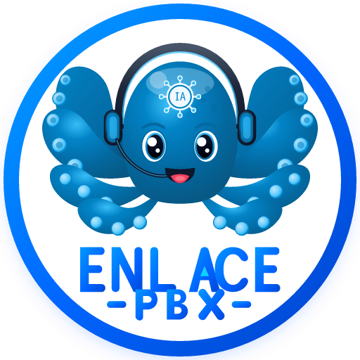

<p align="center">
  <a href="https://enlace.slz.br" target="_blank" rel="noopener noreferrer">
    
  </a>
</p>

<p align="center">
  <strong>Plataforma Omnichannel, Telefonia IP Asterisk 20 LTS & AI Gateway Cognitivo</strong><br>
  <em>Simples, Aberta, Segura e Desenvolvida com Orgulho no Brasil 🇧🇷</em>
</p>

<p align="center">
  
  
  
  
  
  
</p>

---

## 📖 Visão Geral

O **Enlace-PBX Enterprise** é uma central telefônica IP corporativa construída sobre núcleo puro **Asterisk 20 LTS (PJSIP)**, **PostgreSQL com Row-Level Security (RLS)** e **Node.js/Express BFF**, integrando nativamente:

1. **Inteligência Artificial Cognitiva (Google Gemini):** Agentes de voz autônomos (MaIA), transcrição fonética em tempo real, detecção de sentimentos e avaliação automática de qualidade de atendimento (LLM-as-a-Judge).
2. **Contact Center Omnichannel:** Hub unificado combinando chamadas de voz com atendimento via WhatsApp (Meta Cloud API oficial com verificação HMAC-SHA256 sobre payload bruto e idempotência), Webchat e integração bidirecional com CRMs (HubSpot, Pipedrive, RD Station e Salesforce).
3. **Webphone WebRTC Embutido:** Softphone no navegador baseado em WSS e codecs de alta definição (Opus 48kHz, G.722 e G.711) com discador interativo DTMF e DTLS-SRTP.
4. **Editor Visual de URA (IVR Flow Builder):** Menus de atendimento multinível com simulador interativo e geração automática de Dialplan Asterisk (`extensions.conf`).
5. **NOC, Segurança & Conformidade LGPD:** Métricas em tempo real via SSE com tickets efêmeros, console Asterisk CLI, monitoramento VPN (WireGuard/ZeroTier), Fail2ban e trilha de auditoria encadeada com verificação matemática SHA-256.

---

## 🐙 Identidade Visual & Mascote Oficial

<p align="center">
  
</p>

A marca do **Enlace-PBX** traz como símbolo oficial o **Polvo Tecnológico com Headset e IA**:
- `public/logo.png` / `public/logo.svg` — Logotipo oficial horizontal de alta resolução.
- `public/logo-icon.png` / `public/logo-icon.svg` — Emblema do mascote para ícones de sistema e PWA.

---

## 🏛️ Arquitetura de Módulos

```text
                                  ┌─────────────────────────────┐
                                  │      Navegador Web / PWA    │
                                  │ (React 19 + Tailwind + WSS) │
                                  └──────────────┬──────────────┘
                                                 │ HTTPS (443) / WSS
                                                 ▼
┌─────────────────────────────────────────────────────────────────────────────┐
│                             NGINX Reverse Proxy                             │
│       (Certificados Let's Encrypt SSL + Proxy HTTP/3000 + Proxy WSS/8089)   │
└──────────────────────┬──────────────────────────────────────┬───────────────┘
                       │ HTTP / API REST / SSE                │ WSS (8089)
                       ▼                                      ▼
┌──────────────────────────────────────────────┐ ┌────────────────────────────┐
│    Enlace-PBX BFF (Node.js 20/22 Express)    │ │ Asterisk 20 LTS Core (SIP) │
│  ├─ Auth JWT + SSE Tickets + RBAC + RLS      │ │  ├─ res_pjsip (Endpoints)  │
│  ├─ AES-256-GCM EncryptionService            │ │  ├─ res_http_websocket     │
│  ├─ Google Gemini SDK (MaIA AI Gateway)      │ │  ├─ res_srtp / res_crypto  │
│  ├─ WhatsApp Webhook (HMAC rawBody + Idemp.) │ │  ├─ app_audiosocket (ARI)  │
│  ├─ Sondas /health/{live,ready/web,ready/pbx}│ │  ├─ AMI (5038 localhost)   │
│  └─ PostgreSQL 15+ (Role enlace_app + RLS)   │ │  └─ ARI (8088 localhost)   │
└──────────────────────┬───────────────────────┘ └──────────────┬─────────────┘
                       │ ARI REST & WebSocket (8088) / AMI      │ RTP (10000-20000)
                       └────────────────────────────────────────┘
```

### 🧩 Detalhamento dos Módulos do Sistema (27 Módulos Enterprise)

| Módulo | Finalidade | Tecnologias Utilizadas |
| :--- | :--- | :--- |
| **NOC & Dashboard Executivo** | Métricas em tempo real, canais ativos, MOS, CPU e gráficos de tráfego | Recharts, SSE com Tickets Efêmeros |
| **VPNs WireGuard & ZeroTier** | Túneis seguros entre matriz e filiais, monitoramento de latência e perda de pacotes | WireGuard, ZeroTier-One, Telemetria |
| **Segurança & Firewall** | Defesa contra ataques SIP (SIPVicious), Fail2ban integrado e controle do UFW | Fail2ban, UFW, Helmet CSP, Rate-Limit |
| **PJSIP Core & Ramais** | Gestão de ramais SIP físicos e WebRTC, senhas cifradas AES-256-GCM e codecs Opus/G.711 | Asterisk 20, Teluu PJSIP, TLS |
| **Troncos & DIDs** | Interconexão com operadoras VoIP, números virtuais de entrada e portabilidade | PJSIP Trunks, E.164, Regras DID |
| **Rotas de Saída & LCR** | Roteamento de menor custo, planos de discagem BR e proteção anti-fraude (DDI/0900) | Dialplan `extensions.conf`, LCR Engine |
| **Filas ACD & Call Center** | Distribuição inteligente (ringall, roundrobin), agentes com pausa e SLA ao vivo | `app_queue`, Monitoramento de SLA |
| **Campanhas de Discagem** | Discagem ativa preditiva e power dialer com controle de abandono | Motor de Discagem Asterisk, Filas |
| **URA Visual (IVR Builder)** | Criação em fluxograma de árvores de atendimento com áudios e simulador | Canvas interativo, DTMF, Dialplan |
| **Omnichannel & WhatsApp** | Atendimento unificado integrado à Meta Cloud API oficial com HMAC-SHA256 e idempotência | Meta Webhooks 443, AES-256-GCM |
| **CRM Hub 360 & Contatos** | Sincronização bidirecional com HubSpot, Pipedrive, RD Station e Salesforce | Webhooks REST, Customer 360 |
| **AI Gateway (MaIA)** | Agentes cognitivos de voz com áudio em tempo real e Customer Memory | Google Gemini Flash/Live, ARI Stasis |
| **CDR & Gravações** | Bilhetagem com filtros avançados, player WAV/MP3 e transcrição automática | Web Speech API, Storage de gravações |
| **Billing & Tarifador** | Planos pré/pós, tarifação por minuto e relatórios de faturamento em PDF | Motor de Tarifação, JsPDF AutoTable |
| **Asterisk CLI Terminal** | Console interativo no navegador (`asterisk -rvvvv`) e recarga de serviços | Asterisk AMI, CLI Gateway |
| **Snapshots & Rollback** | Backup instantâneo de toda a configuração com restauração em 1 clique | Snapshots PostgreSQL, Rollback |
| **Auditoria & LGPD** | Trilha imutável encadeada por tenant com verificação SHA-256 e exportação SIEM | AuditLogRepository, RFC 5424 Syslog |
| **Infraestrutura & SSL** | Detecção de IP WAN/LAN, NAT Traversal e certificados Let's Encrypt | Certbot, NGINX SSL, IP Tools |

---

## ⚙️ Procedimentos de Instalação e Deploy (Produção)

O **Enlace-PBX Enterprise** é homologado para servidores dedicados ou VPS rodando **Debian 12 (Bookworm)** ou **Ubuntu 22.04 / 24.04 LTS**.

### 🖥️ Requisitos Mínimos e Recomendados

| Recurso | Mínimo | Recomendado (Call Center / IA) |
| :--- | :--- | :--- |
| **Processador** | 2 vCPUs | 4 vCPUs ou mais (compilação rápida e codecs Opus) |
| **Memória RAM** | 2 GB (com 2 GB Swap) | 4 GB a 8 GB RAM |
| **Armazenamento** | 20 GB SSD | 50 GB SSD NVMe (banco PostgreSQL e gravações WAV) |
| **Rede** | 1 Endereço IPv4 Fixo | 1 Endereço IPv4 Fixo + FQDN DNS apontado |

---

### 🛡️ Matriz de Portas do Firewall (UFW / Cloud Security Groups)

| Porta / Protocolo | Serviço | Descrição |
| :--- | :--- | :--- |
| `22/tcp` | SSH | Acesso administrativo remoto |
| `80/tcp` | HTTP ACME | Validação de desafios SSL Let's Encrypt |
| `443/tcp` | HTTPS | Dashboard Web, PWA, Webphone e Webhooks WhatsApp Cloud |
| `5060/udp` | SIP UDP | Sinalização PJSIP padrão de telefones IP e troncos |
| `5061/tcp` | SIP TLS | Sinalização PJSIP criptografada |
| `8089/tcp` | WebRTC WSS | WebSocket seguro do Asterisk para o Webphone |
| `10000-20000/udp` | RTP Media | Fluxos bidirecionais de áudio de voz |
| `51820/udp` | WireGuard | VPN segura entre filiais |

> **Importante:** As portas `5432` (PostgreSQL), `5038` (Asterisk AMI), `8088` (Asterisk ARI) e `3000` (Node.js BFF) devem permanecer restritas a `127.0.0.1` e nunca expostas diretamente à Internet.

---

### 🚀 Método 1: Deploy Automatizado com `deploy.sh` (Recomendado)

O script `deploy.sh` executa o provisionamento idempotente e endurecido para produção:
1. Instala pacotes base, PostgreSQL, NGINX, Certbot e Node.js 20 LTS.
2. Provisiona a base `enlace_pbx` e a role restrita `enlace_app` (`NOSUPERUSER NOBYPASSRLS`) preservando credenciais existentes.
3. Gera backup com timestamp do `.env` existente (`.env.backup.<timestamp>`), preserva customizações e gera chaves fortes para `JWT_SECRET`, `ENCRYPTION_KEY`, `ASTERISK_AMI_PASSWORD`, `ASTERISK_ARI_PASSWORD` e `WHATSAPP_VERIFY_TOKEN` com permissão `chmod 600`.
4. Compila opcionalmente o Asterisk 20 LTS puro com PJSIP, Opus, WebRTC e AudioSocket, sincronizando `manager.conf` e `ari.conf` sem sobrescrever configurações operacionais existentes.
5. Compila frontend e backend (`npm run build`), configura NGINX + Let's Encrypt SSL, aplica UFW, inicia no PM2 e valida via `/health/ready/web`.

```bash
# 1. Acesse o servidor Linux via SSH como root
ssh root@seu-servidor-ip

# 2. Clone o repositório oficial para o diretório padrão
git clone https://github.com/enlaceslz/Enlace-PBX.git /opt/enlace-pbx
cd /opt/enlace-pbx

# 3. Conceda permissão e execute o instalador
chmod +x deploy.sh install-enlace-pbx.sh
sudo ./deploy.sh
```

---

### 🛠️ Método 2: Deploy Passo a Passo Manual

#### 1. Instalar Pacotes Base, PostgreSQL e Node.js 20
```bash
apt-get update -y && apt-get install -y curl git build-essential ufw nginx certbot python3-certbot-nginx postgresql postgresql-contrib
curl -fsSL https://deb.nodesource.com/setup_20.x | bash -
apt-get install -y nodejs
npm install -g pm2
```

#### 2. Provisionar PostgreSQL com Privilégios Mínimos (`enlace_app`)
```bash
APP_DB_PASS=$(openssl rand -hex 20)
sudo -u postgres psql -c "CREATE ROLE enlace_app WITH LOGIN PASSWORD '${APP_DB_PASS}' NOSUPERUSER NOCREATEDB NOCREATEROLE NOBYPASSRLS;"
sudo -u postgres psql -c "CREATE DATABASE enlace_pbx OWNER enlace_app;"
```

#### 3. Configurar Variáveis de Ambiente Obrigatórias (`.env`)
```bash
cp .env.example .env
chmod 600 .env
nano .env
```
Variáveis críticas obrigatórias em produção (`NODE_ENV=production`):
- `DATABASE_URL`: conexão usando a role `enlace_app` (nunca `postgres`).
- `JWT_SECRET`: mínimo 32 caracteres aleatórios (`openssl rand -hex 32`).
- `ENCRYPTION_KEY`: mínimo 32 caracteres aleatórios (`openssl rand -hex 32`) — **faça backup seguro desta chave**.
- `CORS_ALLOWED_ORIGINS`: URL(s) exata(s) do painel (ex: `https://pbx.suaempresa.com.br`; proibido `*`).
- `ASTERISK_AMI_USER`, `ASTERISK_AMI_PASSWORD`, `ASTERISK_ARI_USER`, `ASTERISK_ARI_PASSWORD`: sincronizados com `/etc/asterisk/manager.conf` e `/etc/asterisk/ari.conf`.
- `GEMINI_API_KEY`: chave de API Google Gemini (exclusiva do backend).
- `WHATSAPP_VERIFY_TOKEN` e `WHATSAPP_APP_SECRET`: obrigatórios em produção para validação e assinatura HMAC-SHA256 dos webhooks Meta.

#### 4. Compilar Asterisk 20 LTS e Aplicação
```bash
chmod +x install-enlace-pbx.sh
./install-enlace-pbx.sh

npm ci --omit=dev
npm run build
```

#### 5. Configurar NGINX + SSL e Iniciar com PM2
Configure `/etc/nginx/sites-available/enlace-pbx` apontando `/` para `http://127.0.0.1:3000` e `/ws` para `http://127.0.0.1:8089/ws`, valide com `nginx -t && systemctl reload nginx`, emita o certificado com `certbot --nginx -d pbx.suaempresa.com.br --redirect` e inicie o processo:
```bash
pm2 start dist/server.cjs --name "enlace-pbx"
pm2 save
pm2 startup
```

---

## 🩺 Sondas de Monitoramento (Health Checks)

| Endpoint | Acesso | Finalidade |
| :--- | :--- | :--- |
| `GET /health/live` | Público | Liveness do processo Node.js (`HTTP 200`). |
| `GET /health/ready/web` | Público | Readiness da aplicação Web + PostgreSQL (`HTTP 200` ou `503`). |
| `GET /health/ready/pbx` | Público | Readiness do núcleo Asterisk + socket AMI (`HTTP 200` ou `503`). |
| `GET /health/deps` | JWT + RBAC (`super_admin`, `admin`, `supervisor`) | Telemetria detalhada de dependências com cache TTL de 5s. |
| `GET /api/v1/health` | JWT Autenticado | Status consolidado consumido pelo console NOC e `HealthCheckView`. |

---

## 📋 Comandos Operacionais & Validação

| Ação | Comando |
| :--- | :--- |
| **Verificar tipagem TypeScript** | `npm run lint` |
| **Executar suíte de segurança e regressão** | `npm test` |
| **Compilar cliente + servidor para produção** | `npm run build` |
| **Ver logs da aplicação em produção** | `pm2 logs enlace-pbx` |
| **Reiniciar o PBX Web** | `pm2 restart enlace-pbx` |
| **Acessar o terminal do Asterisk** | `asterisk -rvvvv` |
| **Recarregar Dialplan / PJSIP** | `asterisk -rx "dialplan reload"` / `asterisk -rx "pjsip reload"` |
| **Ver status do Firewall** | `ufw status verbose` |
| **Testar renovação do SSL** | `certbot renew --dry-run` |

---

## 🛠️ Ambiente de Desenvolvimento Local

```bash
npm install
npm run dev
```
O aplicativo estará disponível em `http://localhost:3000`.

---

## 🔒 Segurança & Conformidade com LGPD (Enterprise Security)
- **Autenticação JWT & Tickets SSE Efêmeros:** Sessões protegidas por JWT com interceptor same-origin no frontend e tickets descartáveis de 30s para SSE.
- **CSP Estrita & Defesas de Borda:** `Helmet` em produção com `script-src 'self'` (zero `unsafe-inline`/`unsafe-eval`), `CORS` estrito retornando `HTTP 403` para origens não autorizadas e rate limiting dedicado em `/api/v1/auth/login`.
- **Criptografia Autenticada AES-256-GCM:** Segredos SIP e tokens Meta cifrados em repouso com suporte à rotação segura de chaves (`EncryptionService.rotateKey`).
- **Isolamento Multi-Tenant com PostgreSQL RLS:** Role `enlace_app` sem privilégios administrativos e políticas RLS em todas as tabelas de domínio e auditoria.
- **Trilha de Auditoria Imutável (SIEM-ready):** Cadeia criptográfica SHA-256 por tenant com verificação matemática real e exportação RFC 5424 Syslog.

---

## 🇧🇷 Créditos & Licença
Desenvolvido por **André LJP** e equipe **Enlace Telecom** sob licença comercial / código aberto.  
Dúvidas e suporte técnico: [slzenlace@gmail.com](mailto:slzenlace@gmail.com) | [enlace.slz.br](https://enlace.slz.br)
